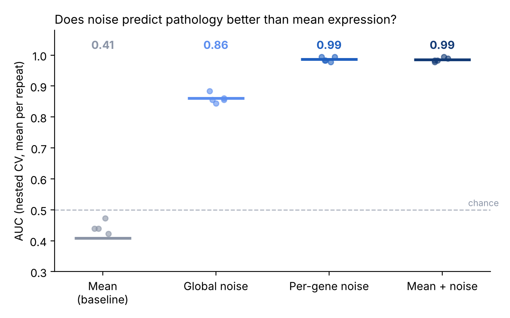

# Transcriptional noise as a predictor of Alzheimer's disease pathology

**Does cell-to-cell expression variability predict Alzheimer's pathology better than mean expression?**

Most single-cell analyses compare **mean expression** between patients and controls. But a cell can keep its mean while losing fine control of its expression, which shows up as more **transcriptional noise** from one cell to the next. This project measures that noise in human brain nuclei (snRNA-seq) and uses it as input to a machine learning model that predicts each donor's Alzheimer's pathology.

## Why it matters (the "so what?")

If noise carries information **that the mean does not**:

- it points to **which cell types lose regulatory control first**, i.e. which cells are vulnerable earliest;
- it proposes a **class of biomarkers** different from classic differential expression;
- and it raises a question that can be tested in independent data.

If it adds nothing, that is a useful result too: the mean is enough, and it is cheaper to measure.

## How I know the result is right

This is the core of the project. With a few dozen donors it is very easy to fool yourself.

| Risk | Control in this pipeline |
|---|---|
| Pseudoreplication: treating cells as independent samples | The model predicts **donors**, not cells |
| Sequencing depth changes apparent noise | Every cell downsampled to the same number of UMIs |
| Cell numbers change the estimated variance | Same number of cells per donor and cell type |
| CV² depends on the mean in an expected way | Uses the **residual** from the mean–CV² trend |
| Information leaking through hyperparameter tuning | **Nested** cross-validation; scaling and imputation inside the pipeline |
| A high AUC by chance | Label-permutation test |
| The model only learns age or sex | Covariate-only baseline |
| The code "runs" but detects nothing | **Positive control**: simulated data with a known variance-only effect |

## Result on simulated data (positive control)

In the simulation, "diseased" donors have more noise in 40 microglial genes **with the same mean**. The pipeline detects it with the noise features and not with the mean features, as expected:



The mean baseline landing slightly below 0.5 is normal when there is no signal and few donors: it is cross-validation noise, not a real effect.

## Real data

| Dataset | Role | Donors |
|---|---|---|
| **Lau et al. 2020** (*PNAS*), prefrontal cortex | Discovery | 21 (12 AD, 9 control) |
| **SEA-AD**, middle temporal gyrus | External validation | 80+, with graded neuropathology |

Lau et al. 2020 enters already preprocessed by my MSc thesis pipeline (QC with per-donor MAD thresholds, ambient RNA removal with decontX, doublet removal with scDblFinder; 137,303 nuclei). Use `config_lau2020.yaml`. With 21 donors, the evaluation relies on many repeated splits and a permutation test, and any result is treated as a hypothesis to be confirmed in SEA-AD (`config.yaml`), not as a finding.

Before running, check the column names with `adata.obs.columns` and the per-nucleus UMI distribution, and adjust the config.

## Usage

```bash
conda env create -f environment.yml
conda activate noise-ml-ad

python scripts/run_pipeline.py --demo        # test on simulated data (~1-2 min)
python scripts/run_pipeline.py --config config_lau2020.yaml   # Lau et al. 2020
python scripts/run_pipeline.py               # SEA-AD (config.yaml)
python tests/test_noise.py                   # tests
```

Outputs go to `results/`: AUC per split (`cv_results.csv`), summary (`report.json`), top-weighted features and figures.

## Structure

```
src/noisead/
  data.py       .h5ad loading and simulation with a known effect
  noise.py      downsampling, per-group statistics, CV² residual, distance to centroid
  features.py   donor-level feature tables (mean, noise, global noise, combined)
  model.py      repeated nested CV, permutation test, coefficients
  plots.py      figures
scripts/run_pipeline.py
config.yaml           SEA-AD
config_lau2020.yaml   Lau et al. 2020
tests/
docs/PLAN.md    project plan and timeline
```

## Author

Alba Pintado Rodrigo · MSc in Bioinformatics and Data Science in Precision Medicine (Instituto de Salud Carlos III). The project builds on my MSc thesis at CBMSO on transcriptional noise in Alzheimer's disease.
